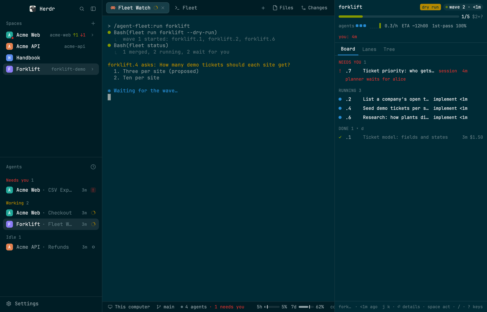
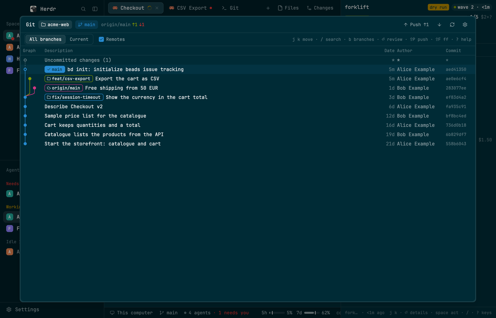
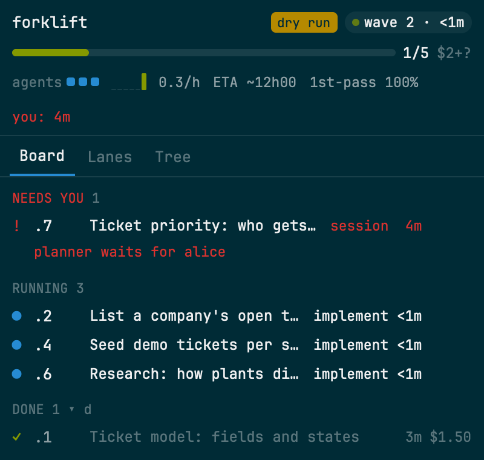

# herdr-layout

A keyboard-first [Herdr](https://herdr.dev) desktop layout for working with coding agents
across many git repositories: a file browser, a git graph you can fetch, fast-forward and push
from, a beads issue tree, a spaces list that shows each repository's worktrees, and a board for
agent-fleet runs.



## What you get

| Key | Opens | What it does |
|---|---|---|
| ⌘O | **File browser** (dialog) | The focused terminal's repository as a tree on the left, the file under the cursor rendered on the right: Markdown with Mermaid diagrams, JSON and CSV tables, images, PDF, source with editing. `/` filters the whole repository. |
| ⌘G | **Git graph** (dialog) | The history of every branch. Fetch, fast-forward every branch that is only behind its upstream, push, commit. Checking out a branch asks: here, or in a new worktree (`.worktrees/<branch>`, opened as a tab in this space); `⇧B` starts a new branch the same way. A branch checked out in another worktree shows a folder icon, and double-clicking it opens that worktree as a tab in the space you opened the graph from. Merging makes a merge commit by default (untick it to fast-forward). Right-click a commit to reset the current branch to it (soft, mixed or hard) or, as in Fork, to move another branch there ("Reset a branch to this commit…": it asks which, and only that branch moves). `/` searches commits, `b` picks a branch (with ahead/behind and its pull request; `⌃O` worktree, `⌃D` delete, `⌃X` remove its worktree), `⇧R` switches to another repository (or click its name), ⏎ reviews a commit as changed files beside their diff (`c` switches to everything since the base branch, as a PR shows it; ← goes back out, ⏎ or ⇥ again closes it), `v` views a file as it was at that commit in the file browser, `o` opens it in your editor, `d` shows the change in your diff tool, and on the uncommitted changes `r` resets a file (unstage it or discard its change, after asking). |
| ⌘B | **Beads** (dialog) | The [beads](https://github.com/steveyegge/beads) issues of the focused repository as a foldable tree, with details, editing and labels. |
| ⌘N | **New space** (dialog) | Asks for a name and a folder: type to filter the git repositories under your code folder (`~/Code`, or `code_dir` in the [settings](#settings)), with the one you're in first, then recent ones; or Home, or Browse… for any folder. Opens a space there with that name, its first tab named the same, and Claude Code running there as the Remote Control session of that name (`claude --remote-control <name>`). All from the keyboard: Enter right after the name opens it in the repository you're in; Tab moves to the folder, ↑↓ pick, Enter opens. The + in the spaces list and a worktree's "Open as space" ask the same way. |
| ⌘⇧O | Side panel | [Preview Plus](https://github.com/linziyanleo/herdr-mods) (the file tree with a rendered preview; Escape goes back) and Herdr's Changes panel. |
| ⌘⇧F | **Fleet board** (pane on the right; ⌘⌥F as a large dialog) | An [agent-fleet](#fleet-board) run beside your agents: what needs you first, where every bead is, where its time went, and the gate's answer or resume right there. See [Fleet board](#fleet-board). |



In the sidebar, every space of a repository lists the repository's git worktrees under it
(folded until you unfold them), with ahead/behind counts, last activity and the branch's pull
request. Clicking a worktree goes to where it is already open (its own space, or a tab in it);
double-clicking opens it as a tab in that space, or shows the tab it has there. A worktree can
be open as a tab in several spaces. Right-click it for its menu, which starts with that tab:

- **Open** it as a tab in this space (first; "Go to" once it has one), go to a tab another
  space has, open it as a space, show its changes, or open it in your editor.
- **Git:** pull, push (setting the upstream the first time) and fetch; rebase onto or merge the
  main checkout's branch when the worktree is behind it; create or open its pull request; open
  it in the git graph; copy the branch name. Each runs in the background and reports as a toast.
  A rebase or merge that hits a conflict is undone rather than left half way. When the remote
  refuses a push after a rebase, you're asked before it force-pushes, and the force push still
  stops rather than overwrite commits someone else pushed that your branch doesn't have.
- **Folder:** copy its path, reveal it in Finder, close its space, or remove the worktree
  (Herdr's own removal when it has a space, or your command after asking if the repository sets
  `git config herdr.worktreeRemove '<cmd>'`, with `{path}` and `{branch}` filled in).

A worktree whose pull request was merged or closed, or whose remote branch is gone, is dimmed
and says so. Its menu starts with **Clean up…**, which shows what would be lost, then removes
the worktree, deletes the branch and closes its space or tab.

A repository space's own menu has pull, push and fetch as well.

The agents list shows each agent with its space's avatar. The status bar can show your Claude
subscription usage (see below).

All three dialogs and the fleet pane use the same keys, for vim and arrow users alike: `j k` or
`↑ ↓` move, `l →` go in, `h ←` come out (⏎ ⇥ toggle), `/` searches, `?` lists every key, Esc
closes. In the fleet pane `space` runs the bead's first action and ⌘← ⌘→ switch fleet runs.

## Fleet board



For repositories that run [beads](https://github.com/steveyegge/beads) epics with
agent-fleet, the coordinator that hands beads to Claude Code agents in waves (implement,
check, review, fix, merge) and stops at gates when it needs a person. agent-fleet isn't public
yet; without it the board stays hidden and does nothing. The board shows one
epic, read from `fleet status --json`, and follows the repository of the focused terminal.
It reads again when the run's state changes on disk, so it is live without polling.

**The header** says which epic, whether a wave runs (the wave pill: wave 7 · 2h45), progress
(merged of all, dropped ones counted as closed) and cost. Below that: the agents at work
(implement, fix and review take one; checks and merges don't), beads merged per hour, an ETA,
how often a review passes first time, and, once agent-fleet reports gate history, how often and
how long the fleet waited for you.

**Two views of the same beads**, each bead drawn as the same one-line row (state, id, title,
what its section doesn't already say, fix rounds `↻2`, a small bar of its phases, time,
cost), sharing one selection:

- **Board** groups beads by what needs you: needs you, running, interrupted, waiting on
  GitHub, queued, blocked, done. A bead others wait for shows how many it unblocks (`⇣3`), a blocked
  one what it waits for, and when beads wait on each other the critical path (the longest chain,
  which bounds when the epic can finish) sits above the queued ones, its ids in the accent colour. A
  finished epic opens with a recap: totals, agent time, the costliest, longest and most-fixed beads.
- **Lanes** draws every bead's steps over time: a full bar where an agent works (blue implement
  and fix, violet review), a thin line for a check (grey) or the merge (green), red only where
  something was sent back or the fleet waited for you, with the agents at work and wave boundaries
  underneath. It fits the whole run to the width; `[ ]` zoom from 1 hour to 7 days.

**A bead's details** (⏎ or click; one row is open at a time, and the details follow `j k`):

- where its time went: start to merge, agent time, check time, time queued between steps
  (waiting for a worker, the next wave or you), fix rounds, cost, lines changed;
- its life to scale, each step in its phase's shade, the waits as a hairline;
- every step under its round (BUILD, FIX ROUND 1, …) with when it started, how long it took
  and what came of it in words: `stopped: time limit`, `asked for changes`, `re-check` (checked
  again after a rebase onto a newer epic branch);
- the times it waited for you and how each ended, and its actions: **diff** opens the git graph
  on what the bead changes, **beads** opens it in the beads view, **tail** follows its log.

**Acting on a run.** A bead that asks you something shows its questions with the agent's
options as choices, its proposal preselected, and a field for your own words; **Send answer**
runs `fleet answer`. A bead stuck without a question (a step failed) offers **resume**, with an
optional note for the agent. Commands that change the run (resume, approve, drop) ask first in
a bar under the tabs that shows the command: ⏎ runs it, **Copy** copies it instead, Esc
cancels; the result arrives as a notification. The wave pill stops the running wave
(`fleet stop`) or starts the next one (`fleet run <epic>` in a terminal below), after the same
question.

**The tail.** `t` shows the open bead's `fleet tail` at the bottom of the pane and follows it
while it runs. Lines stay on one line; hover shows a line whole, a click wraps it, **wrap**
wraps them all. (agent-fleet itself shortens long lines unless it has `fleet tail --full`,
which the board uses when it's there.)

**Several runs.** When fleets run in more than one repository, a strip of chips above the
board lists each run of the last week: a dot while its wave runs, a red count of beads waiting
for you, finished runs dimmed. Click one, or ⌘← ⌘→, to show it until you focus another folder.

**Notifications.** A bead that starts waiting for you posts a notification, also while the
pane is hidden (it then looks every 2 minutes); clicking it shows the pane.

| Keys | |
|---|---|
| `j k` `↑ ↓` `⌃N ⌃P` | move; `⌃D ⌃U` page, `g G` ends |
| `⏎ ⇥` | open or close the bead's details; `l →` open, `h ← x` close |
| `space` | the bead's first action (answer, resume, tail) |
| `/` | filter by id or title; `⌫` clears |
| `t` `b` `d` | tail, beads view, fold the done beads |
| `[ ]` | zoom the lanes |
| `r` | read again |
| ⌘← ⌘→ | previous or next run |
| `?` | every key |

**Setting it up.** It needs agent-fleet 0.33 or later (`fleet status --json`); later versions
add the strip's `fleet runs --json`, gate history and whole tail lines, and the board uses
each once it's there. The pane is hidden until ⌘⇧F. Another `fleet` than the one on your PATH
(a checkout's `scripts/fleet`, say) goes in the [settings](#settings) as `fleet`. To pin a layout block to one repository instead of following the
focused terminal, give it props `{"repo": "/path/to/repo"}`.

## Install

Herdr installs layouts through its agent. In a terminal in Herdr, tell Claude Code (or
another agent):

```text
Read ~/.config/herdr-app/AGENTS.md, then add this layout: https://github.com/jocrau/herdr-layout
```

It copies the layout and mods into `~/.config/herdr-app`, renames anything whose name you
already use, merges `keys.json` (asking before it replaces a key you have bound), checks each
mod and switches to the layout. `ctrl-shift-l` switches back to your previous layout; deleting
`layouts/workbench.json` and the mods removes it.

By hand, from a clone of this repository:

```sh
cp -R mods/* ~/.config/herdr-app/mods/      # check for name clashes first
cp layouts/workbench.json ~/.config/herdr-app/layouts/
# merge keys.json into ~/.config/herdr-app/keys.json
for m in mods/*/; do herdr-app check ~/.config/herdr-app/mods/$(basename $m); done
herdr-app do layout.switch '{"name":"workbench"}'
```

## Needs

| For | Install |
|---|---|
| Everything | The [Herdr desktop app](https://herdr.dev) (macOS), `git` |
| Pull requests in the sidebar and the worktree menu | [`gh`](https://cli.github.com), logged in |
| ⌘B beads | [`bd`](https://github.com/steveyegge/beads), [`fzf`](https://github.com/junegunn/fzf) 0.59 or later, `python3` |
| ⌘⇧F fleet board | agent-fleet's `fleet` 0.33 or later (not public yet; see [Fleet board](#fleet-board)) |
| `o` and `d` in the git graph | Git's editor and diff tool, set in git so Herdr finds them however it was started: `git config --global core.editor "code --wait"` and `git config --global diff.tool vscode`. Without an editor, `o` uses the system's app for the file type |
| `claude-resume` after a reboot | Optional: [`extras/claude-resume`](extras/claude-resume) and the status line below (see [Resuming Claude sessions](#resuming-claude-sessions-after-a-reboot)) |
| Usage in the status bar | Optional: a Claude Code status line that writes `~/.local/state/claude-usage.json`, such as [`extras/claude-statusline.py`](extras/claude-statusline.py) (see [Status bar usage](#status-bar-usage)) |

Everything else is optional: a missing tool hides its feature.

## What it runs and reads

Nothing here talks to a server of its own. The mods run local programs and read files outside
their folders, which is how they get their data:

- **Programs:** `git` (status, log, fetch, pull, push, worktree; fetch, pull and push reach
  your remotes), `gh` (pull requests, on GitHub), `bd` and `fzf` (the beads view), `python3`
  (beads-view, the extras), `fleet` (the fleet board), `herdr-app` and `hc`, and your editor and
  diff tool when you ask for them.
- **Files read:** your repositories; the layout's settings file (see [Settings](#settings)); agent-fleet's state under `~/.local/state/agent-fleet` (watched for changes);
  `~/.local/state/claude-usage.json` for the status bar; `~/.claude/projects` (only
  `claude-resume`, to find a session's transcript).
- **Files written:** only by your actions (a commit, an edit in the file browser, a beads
  edit), plus the mods' own remembered sizes and settings in Herdr's storage. Two exceptions:
  the git graph adds `/.worktrees/` to a repository's `.git/info/exclude` the first time it
  makes a worktree there, and `extras/claude-statusline.py`, if you set it up, writes the usage
  file and labels its terminal.

## Settings

The layout works without settings. Two can be set in `~/.config/herdr-app/data/workbench.json`:

```json
{ "code_dir": "~/Projects", "fleet": "~/src/agent-fleet/scripts/fleet" }
```

- `code_dir`: the folder whose git repositories ⌘N and the git graph's ⇧R offer (default
  `~/Code`, searched 4 levels deep). A home folder (`"~"`) is searched only 2 levels deep, and its
  Desktop, Documents, Downloads, Library and media folders are skipped.
- `fleet`: the `fleet` command the fleet board runs (default: `fleet` on your PATH).

## Status bar usage

The status bar shows your Claude subscription usage (the 5-hour and 7-day windows: share used,
pace, projection at reset) once `~/.local/state/claude-usage.json` exists. Claude Code only
hands those numbers to its status line, so a status line has to save them.
[`extras/claude-statusline.py`](extras/claude-statusline.py) does that, and shows a compact
line itself: model and effort, context used, a hint when each call reads a lot of tokens, and
usage from 80 %. Inside Herdr it leaves out the repository and branch, which the space and
tabs already show. It needs only `python3` and `git`. The layout install doesn't copy it; from
a clone of this repository (or ask your agent to do both steps):

```sh
cp extras/claude-statusline.py ~/.claude/
```

and in `~/.claude/settings.json`:

```json
"statusLine": {"type": "command", "command": "python3 -I ~/.claude/claude-statusline.py"}
```

Inside Herdr it also labels its terminal with the context used (`claude.context`), and
`space-agents` shows it on each agent's row as a short bar and percent, yellow from 60 % and
red from 80 %, so you can see which agent needs a `/compact` without switching to it. The
`SessionEnd` hook below clears the label.

Already have a status line you like? Keep it, and have it write the file instead: the
`save_usage` function in the script shows the format (`{"seen_at": …, "rate_limits": …}`,
the `rate_limits` Claude Code passes in, merged across sessions).

## Resuming Claude sessions after a reboot

Herdr keeps your terminals through a reboot or logout, but each comes back as a fresh shell:
the Claude Code session that ran there is gone (Herdr never reruns a command). With
[`extras/claude-statusline.py`](extras/claude-statusline.py) as your status line, each
terminal is labelled with its session while Claude runs, and
[`extras/claude-resume`](extras/claude-resume) brings them back: run it in any terminal, check
the list, say yes, and each terminal that lost its session runs `claude --resume` from the
session's own folder. Sessions come back without Remote Control (`/remote-control` turns it
on again).

```sh
cp extras/claude-resume ~/.local/bin/    # or anywhere on your PATH
```

So that a session you quit yourself isn't brought back, add this hook to
`~/.claude/settings.json` (it drops the terminal's label when Claude ends):

```json
"hooks": {"SessionEnd": [{"hooks": [{"type": "command",
  "command": "python3 -I ~/.claude/claude-statusline.py --session-end"}]}]}
```

## Updating

The install copies files, so updates don't arrive by themselves. To update, tell your agent:
"Update the herdr-layout mods from https://github.com/jocrau/herdr-layout, keeping my
changes". The [CHANGELOG](CHANGELOG.md) says what changed.

## Development

`node --test 'tests/unit/*.test.mjs'` and `python3 -m unittest discover -s tests/unit -p 'test_*.py'` run
the unit tests: the fleet board's and the git graph's logic, beads-view with a fake `bd`, every mod's
modules loading and linking (Herdr's own modules stubbed), and, with a global ESLint, no name used without
being declared or imported. `tests/worktrees/RUNBOOK.md` is a manual pass over the git and worktree actions.
A mod's folder is linked into Herdr, so try changes in the demo window (below) or a worktree first.

## Screenshots

The images here come from [`tests/demo/make-demo.sh`](tests/demo/make-demo.sh): it builds made-up
repositories and a fleet dry run in `/tmp/herdr-demo` and opens them in a second Herdr window with
its own home, terminal session and fleet state, so your own window, terminals and runs are never
touched. Its agents are stand-ins ([`tests/demo/fake-agent.py`](tests/demo/fake-agent.py)) that
report working, blocked or done to Herdr and show a made-up session; the window takes your theme
and fonts from your own `settings.json`. `build`, `up`, `fleet`, `shot <file>`, `down`, `clean`.

## Credits and licences

Built on mods by [Nate Landau](https://github.com/natelandau/herdr-worktree-support),
[Rabeeh T A](https://github.com/rabeeh-ta/herdr-git-graph),
[linziyanleo](https://github.com/linziyanleo/herdr-mods) and Herdr's own. Each keeps its licence;
see [THIRD_PARTY.md](THIRD_PARTY.md). The rest is MIT ([LICENSE](LICENSE)).
