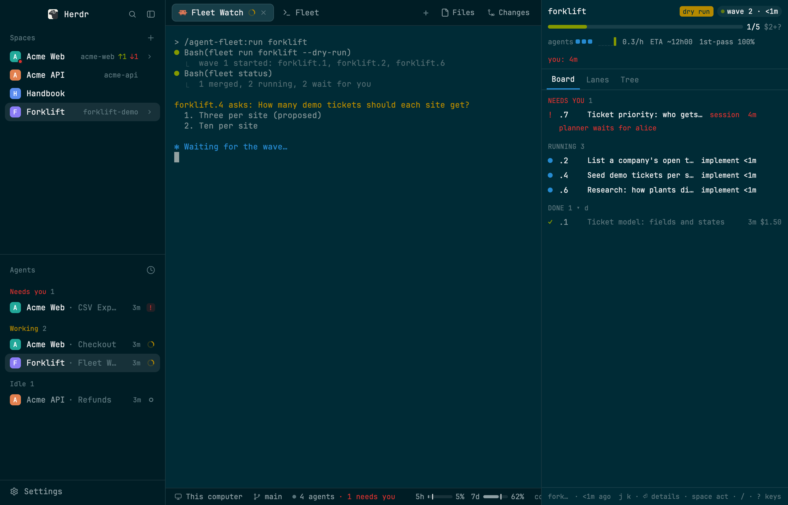

# workbench

A keyboard-first Herdr layout for agents working across many git repositories. Herdr's `main`
layout with a worktree-aware spaces list, an agents list with space avatars, a tab bar with
icon links to these mods (Files, Git, Beads; PRs, Fleet), a status bar with Claude usage, three full-size
dialogs on ⌘O, ⌘G and ⌘B (a file browser, a git graph and a beads issue tree), and on ⌘⇧F a
fleet board for agent-fleet runs, all driven by one set of keys.



## What you see

Left to right:

1. **Sidebar** (`sidebar`, 268 px, 44–480): Herdr's brand row (`workspace-chrome`, 46 px, drags
   the window); the **spaces list** (`worktree-support`) and the **agents list**
   (`space-agents`) sharing the height equally (each at least 90 px); the footer
   (`sidebar-footer`, 41 px: Herdr's footer with only the Settings button).
   - A space row: an 18 px avatar in the space's colour with its first letter; a dim 8 px
     badge on its bottom-right corner when an agent in it is blocked (the theme's blocked
     colour) or done (done colour); the name; right-aligned in dim 11.5 px the repository and
     branch when they differ from the name (`main`/`master` hidden) and ↑ahead (`ansi2`)
     ↓behind (`ansi1`); then an 18 px slot holding the fold chevron (› folded, ⌄ open) for a
     repository with worktrees, empty otherwise, so names and chevrons line up.
   - A space whose terminals are in several repositories shows `N repos` in dim instead.
   - A space whose terminal is in a linked worktree is a top-level row like any other, with
     the repository and branch after its name; spaces are never nested.
   - Under every space of a repository (main checkout or worktree), folded behind its chevron
     until unfolded (per space, `localStorage` "worktrees.open"): one row per linked worktree
     that no space is in. Its menu has "Open as tab in <this space>" (unless this space has
     one there) and "Go to tab in <space>" (this space's tab, else another's), so a worktree
     can be open in several spaces; the menu starts with the tab in this space ("Open as tab
     in <space>", or "Go to tab" when it has one), which a double-click does; a single click
     goes to a tab already in it, 28 px, indented 22 px, a branch
     icon, the branch, ↑/↓ against the main checkout's branch, the pull request number coloured
     by state (green open, dim draft, `ansi5` merged, `ansi1` closed, with ✓ ✗ ◌ for checks)
     and the time since the worktree last changed. Newest first. A finished worktree (its PR
     merged or closed, or its upstream gone: status has `branch.upstream` but no `branch.ab`)
     is drawn at 55 % opacity with "merged", "PR closed" or "remote gone" before the PR.
   - An agents row shows the agent's space avatar instead of the program logo.
2. **Work column**: the **tab bar** (`tabs-graph`, 42 px: the tabs with + right after them, then icon links that
   open the file browser, git graph and beads and show or hide the PR and fleet columns); the terminal area; on the right a
   hidden **side panel** (368 px, 280–900; ⌘⇧O or the `tabs-graph.files` / `.changes` commands; a `side-header`
   header with Preview · Changes tabs and a ×) stacking `preview-plus` (linziyanleo, MIT) and Herdr's `changes`; the
   **status bar** (`usage-status`, 28 px) with Claude usage on the right when available.
Side columns (the side panel, the PR column, the fleet column) are open one at a time: opening one closes the
other. They close the same three ways: the × at the right of
their header (its tooltip names the key), Esc once nothing in them is left to clear (a filter, a question, an open
item), and their key (⌘⇧O, ⌘⇧R, ⌘⇧F), which opens them too, as the PR and fleet columns' links in the tab bar do
(highlighted while open). `lib/sidecolumn.js` holds the ×, and which key goes with which column.

3. **Fleet column** (`fleet`, 400 px, hidden until ⌘⇧F): `fleet-board`, full height. Top to
   bottom: the header (`lib/boardheader.js`, as the PR board's: the epic with a chevron that opens
   the run list as a dropdown over the board, the repository and mode, ↻ and ×); the wave pill ("wave 7 ·
   2h45" with a green dot, or "finished · 2d ago") beside a progress bar
   (merged in `ansi2`, dropped in grey) with "13/18 −1 $29"; a gauge row in 11.5 px (agents:
   one 7 px square per worker, blue when busy; a merged-per-hour sparkline; "1.3/h", "ETA
   ~2h15", "1st-pass 80%", and "you: N waits · ~Xm" with gate history); tabs Board · Lanes ·
   Tree; the confirm bar when a command waits for ⏎; the view; the tail panel (14 lines of 16
   px, monospace) when on; a footer of key hints.
   - A bead row is 24 px: a state glyph (● running `ansi4`, ! needs you `ansi1`, ✓ done, ○
     queued), the short id (`.runs` within the epic; capped at 11 characters, truncated), the
     title, a tag of what the section doesn't say (`fix 1`, `check`, `questions`, `PR #412`,
     `after .7`, `stuck`), `↻N` fix rounds, a 40 px phase bar (from 480 px wide), time and cost.
     Columns size to their widest value so they line up; the title takes the rest.
   - An open row: the title on its own line under the id, wrapping; then the details on the
     row's hover background: a summary line, a 10 px timeline to scale with hh:mm at both ends,
     and a step table under round headings (BUILD, FIX ROUND n: a rule, then "wave 5 · $0.45"),
     each step "19:47 ▪ check 2m passed".

The three dialogs open over the tab at 92 % × 90 % of the window:

- **⌘O File browser** (`file-browser`): a 320 px tree pane (repository name, a `/` filter
  field, the tree with git marks A/M/D, a key hint footer) beside the viewer: rendered
  Markdown with Mermaid diagrams, JSON as a foldable tree, CSV/TSV as a table, images and PDF
  with zoom, everything else as source in an editor (⌘S saves).
- **⌘G Git graph** (`git-graph`): header with the branch, its upstream and ↑/↓, and buttons
  for Fast-forward N, Push, fetch and refresh; a toolbar (all branches / current, remotes, the
  search field, a key hint); the graph table; below it, when a commit is reviewed, a resizable
  split of the commit's header and changed files (left, 34 %, 300–560 px) beside the selected
  file's diff.
- **⌘B Beads** (`beads`): `beads-view` (fzf over `bd list`) running in a terminal in the
  dialog: a foldable issue tree with a details pane.

## How it behaves

Agent status: working shows a spinner in the tab bar; blocked and done show as the space
avatar's corner badge and a dot on the tab. Idle shows nothing.

**Shared keys in all three dialogs**: move `j k ↑ ↓ ⌃N ⌃P`; page `⌃D ⌃U PgDn PgUp`; ends
`g G Home End`; in `l → ⏎`; out `h ←`; next/previous item while viewing `J K`; sections `[ ]`;
search `/`, clear `⌫`; switch pane `⇥`; help `?` (any key closes it). Esc closes the dialog
(Herdr handles it; a mod never sees it). Changes take Shift.

- **File browser.** Moving the cursor previews the file after 120 ms. `l →` opens a folder,
  steps into an open one, or shows a file; `h ←` closes a folder or goes to its parent. `⏎`
  opens the file and moves the keyboard to the viewer. `/` filters every file of the
  repository (git's list, else `find`, at most 20,000) with an fzf-like score; `⏎` in the
  filter opens the file, reveals it in the tree and clears the filter. In the viewer (no
  editor showing): `j k` scroll (Markdown by block: only lists of known row heights scroll
  from code, so the view starts at a later block; JSON and CSV by row), `⌃D ⌃U space` a page,
  `g G` top/end, `[ ]` headings, `s` source/preview, `c` contents, `⌫` back after a link,
  `o` open in its app, `J K` next/previous file; `h ← ⇥` back to the tree.
- **Git graph.** `[ ]` labelled commits, `{ }` branches, `t` local branch ⇄ its upstream,
  `.` HEAD, `u` upstream, `m` main, `^` first parent, `a` all/current branches, `space` the
  row's actions menu. `/` searches subjects, authors, hashes and refs (every word must
  appear), `n N` next/previous, loading more history as needed (15 pages at most). `b` lists
  every local and remote branch, newest first, fuzzy filtered: `⏎` jumps, `⇧⏎` checks out.
  `⇧R` (or the repository's name in the header) switches to another repository: the code
  folder's (`code_dir`, else `~/Code`, 4 levels, as New Space), this one and recent first,
  fuzzy filtered, Browse… for any folder; the graph stays on it instead of following the
  focused terminal until it closes.
  `⏎ ⇥ l →` review the cursor commit: the file list takes the keyboard, `j k` files (the diff
  follows), `J K` commits, `⌃D ⌃U space` scroll the diff, `[ ]` hunks, `o` opens the file in git's
  editor (`git var GIT_EDITOR`: core.editor, VISUAL, EDITOR; a terminal editor in a new tab,
  others as a background herdr-core terminal; none: the system's app); a file not in the working
  tree shows as `d` does. `d` shows the change in `git difftool` (diff.guitool, else diff.tool),
  which writes and removes the versions it compares; an added or deleted file opens as the one
  version there is (diff tools show an empty side badly): the working-tree file, else as `v`.
  `v` shows the file as it was at the commit in the file browser, over the graph (read from
  `git show`, read-only, nothing written; Esc comes back). `- =` resize, `c` this commit ⇄
  everything since the base branch (from the merge base, as a PR shows it; the uncommitted row
  runs to the working tree; base: origin/HEAD, main, master, or the Review base setting).
  `r` on a file of the uncommitted changes resets it after a dialog: Unstage (`git restore
  --staged`, offered when it's staged) or Discard (`git restore --source=HEAD --staged
  --worktree`, which deletes a new file); an untracked file is deleted (`git clean -f`).
  `h ←` step out: files → graph → review closed; `⏎ ⇥` again or `x` close.
  Drag the line above the review to resize (double-click: half), and the line between its
  files and diff (double-click: back to a third); both sizes are remembered.
  `f` fetch, `⇧F` fast-forward every branch only behind its upstream (`merge --ff-only` for
  HEAD, `fetch . upstream:branch` for others), `⇧P` push the current branch (asks first),
  `⇧C` commit (asks for a message), `r` refresh. Double-click a label to check it out; on a
  remote label (`origin/x`) it checks out the local branch that tracks it and, when that only
  lacks the remote's commits, fast-forwards it first, as Fork does (diverged: a toast says so).
  Checking out asks where (⏎: Here): double-click a branch label, its menu's Checkout…, `⇧⏎`
  in `b`, or a remote branch with no local one. "New worktree" runs `git worktree add` into
  `<main checkout>/.worktrees/<branch>` (slashes as dashes; opened as a tab named in words,
  "feat/csv-export" → "Csv Export"; `/.worktrees/` goes into
  `.git/info/exclude` once, so status ignores it; a taken folder is refused before git makes
  the branch), then goes there as below. `⇧B` makes a branch at the cursor commit (HEAD on
  the uncommitted row): just made, checked out here, or in a new worktree. In `b`, rows show
  ↑/↓ against the upstream and the open pull request (`gh pr list`, when gh is there); `⌃O`
  goes to the branch's worktree or offers a new one, `⌃D` deletes it (not one checked out),
  `⌃X` removes its worktree, `⌃T` lists only branches in worktrees. "Remove worktree…" (also
  in a worktree branch's menu) runs the repository's `herdr.worktreeRemove` command when it
  sets one, else `git worktree remove`, refusing uncommitted changes unless ticked, says when a space or tab is open there, and can delete the merged branch too.
  Worktrees: a branch checked out in another worktree (`for-each-ref %(worktreepath)`) has a
  folder icon instead of the branch icon, here and in `b` ("in <folder>"). Double-click, `⇧⏎`
  or `⌃O` in `b`, or its menu's first item "Open its worktree here" opens it as a tab in the
  space the graph was opened in: the tab that space already has there, else a new one named
  after the branch in words (other spaces may have it open too); the graph closes. Its remote label fast-forwards it in that worktree (`git -C <worktree> merge
  --ff-only`) first. `⇧F` leaves these branches out (someone, maybe an agent, works there);
  their menu has no Checkout or Delete but has "Copy worktree path". Shown in a linked
  worktree, the header reads "<repository> worktree <folder>". Git's usual refusals (branch in
  another worktree, uncommitted changes in the way, not fully merged, push rejected, diverged,
  conflict) come with a plain sentence and what to do first, then git's own words.
- **Beads.** Starts with the filter hidden, so letters are keys. `l →` unfolds a folded bead,
  else focuses a bead with children or shows a leaf's details (with details showing: edit);
  `h ←` folds an open bead, else goes to its parent or up out of the focus; `space` folds;
  `⏎ ⇥` toggle details; `1-9` / `0` fold to that many levels / unfold; `/` shows the filter
  (exact words, all must appear: `'word` fuzzy, `!word` excludes; Esc clears and hides it, then quits);
  `f` only beads with chosen labels and priorities (one namespace or P0-P4: any of them), `⇧F`
  clears it; `⌃E` edit, `⌃L` labels, `⌃A` open/all beads. In the `f` and `⌃L` pickers `⏎`/`space`
  tick, Esc applies, `⌃C` cancels.
- **Spaces list.** Click a space to select it, drag to reorder, right-click for its menu
  (open in VS Code/Cursor, copy path, New/Open/Remove worktree). Click a worktree row: a
  space already there is selected, else a tab in the repository's space that is already in
  the worktree, else a new tab there. The chevron folds a repository's worktrees. The PR
  number opens the pull request. A finished worktree's menu starts with "Clean up (merged)…":
  a dialog says what goes (the folder, uncommitted changes if any, how many commits are on no
  remote and not in the base, the space or tab that closes; red when something is lost),
  then it removes the worktree (the repository's `herdr.worktreeRemove` command if set, else
  `git worktree remove`, `--force` only when the dialog said changes are lost), deletes the
  branch (`-D`: a squash merge leaves its commits unmerged; already gone is fine), and closes
  only the space or tab the dialog named.
- **Fleet board.** Shows the run chosen in its run list (`fleet runs --json`: every epic of every
  repository, read with `fleet status --repo <folder> --epic <epic>`; a run without its folder is
  looked for as `<code_dir>/<repo>`; ⌘← ⌘→ step through it), kept in shared state across restarts; the focused terminal's repository only picks the
  first one when none was ever shown (props `{repo}` pin it to one), reads
  `fleet status --json --repo <folder>` and re-reads when anything relevant changes under the
  run's state directory (`watchFolder` on `<state>/<repo>`: events.jsonl, wave.json, run.json,
  state.json, run.lock, gates/*.json, merge.json), with a 60 s read as backstop. Keys: `j k ↑ ↓
  ⌃N ⌃P` move, `⌃D ⌃U` page, `g G` ends, `⏎ ⇥` toggle the details, `l →` open, `h ← x` close,
  `space` the first action, `/` filter (`⌫` clears), `t` tail, `b` the bead in the beads view
  (`openOverlay` beads with `{select, folder}`), `d` folds Done (open at start), `[ ]` zoom the
  lanes (1 h … 7 d, fit), `r` read again, `e` the run list (again or esc closes it), `?` keys, ⌘← ⌘→ (`fleet-board.prev-run/next-run`, the
  `mod:fleet-board` keys section) the previous or next run. One row is open at a time and
  the details follow the selection. A parked bead with questions shows each with the agent's
  options as radio rows (its default preselected, marked "proposed"), a textarea and **Send
  answer** (`fleet answer <bead> --file <tmp>`, the text written to a temporary file). One without questions (a step
  failed: "stuck") puts **resume** first, filled with the accent colour; "+ resume with a note
  for the agent" opens the textarea. Read-only commands (`fleet tail`, `fleet gate show`) open in
  a terminal below the tab (`terminal.open`, place down); ones that change the run (resume,
  approve, drop) open the confirm bar ("Resume .x?", what it means, the command; **Resume ⏎**,
  **Copy**, **Cancel esc**), then run with the configured `fleet` (120 s timeout) and post
  "Done:"/"Failed:" with the last 4 lines. The wave pill stops a running wave (`fleet stop
  --no-wait`) or starts the next (`fleet run <epic>` in a terminal), after the same bar. **diff**
  opens `git-graph` with `{review: {base, head}}`. Every 2 minutes while hidden, one read per
  run checks for newly parked beads; each new wait posts one warning notification (deduped
  across copies via `shared("fleet-board.alerted")`) whose click shows the pane. The run
  list reads `fleet runs --json` once a minute, else by trying `fleet status` in the
  spaces' folders one folder per pass.
- **Status bar usage.** When `~/.local/state/claude-usage.json` exists it shows the 5-hour
  and 7-day windows: used share, pace and projection at reset (yellow from 90 %, red from
  110 % projected). `extras/claude-statusline.py`, set as Claude Code's status line, writes
  that file (README, "Status bar usage").
- **After a reboot.** herdr-core gives every kept terminal a fresh shell and never reruns its
  command (Herdr's AGENTS.md: "its original command is never run again"). The status line
  labels its terminal `claude.session=<id> claude.folder=<project dir>` (`hc label`, only when
  it changes; herdr-core keeps labels); its `--session-end` hook clears them on `/exit` and
  `/clear`. `extras/claude-resume` lists live terminals back at a shell that still carry the
  label and whose transcript exists (`~/.claude/projects/<folder, non-alphanumerics as ->/<id>.jsonl`),
  asks, then `hc send`s `cd <folder> && claude --resume <id>` to each.

## Built from

Layout (`layouts/workbench.json`, from Herdr's `main` 0.1.13):

```
root row
  sidebar column: brand(workspace-chrome) / sidebar-lists(spaces: worktree-support, agents: space-agents) / sidebar-footer(sidebar-footer)
  work column: tabs(tabs-graph) / work-body row(main, panel column [hidden] → panel-body stack(files: preview-plus, changes: changes)) / status(usage-status)
  fleet [hidden, 400 px]: fleet-board
```

Mods: `worktree-support` and `worktree-actions` (natelandau, MIT; worktree rows, the right-click
popups), `new-space` (Herdr's `prompt`; ⌘N and the spaces list's +: asks a name, then `space.new`
with that name for the space and its tab and `claude --remote-control <name>`), `space-agents` (Herdr's `agents`), `tabs-graph` (Herdr's `tabs`; commands
`tabs-graph.files`, `tabs-graph.changes`; its links as icons: the dialogs, then the side columns;
one side column at a time; the wheel switches tabs one per notch, a sideways swipe scrolls them),
`side-header` (the side panel's header: its views as tabs and a ×), `usage-status` (Herdr's `workspace-status`),
`file-browser` (its own `main.js` subclassing preview-plus's viewer as `viewer.js`),
`git-graph` (rabeeh-ta, MIT; `mod.json` overlay dialog; `graph.js` holds the Graph's lifecycle, its methods are
mixed in from `table.js`, `review.js`, `pickers.js` and `manygit.js`, with `reads.js`, `tools.js` and
`common.js` beside them; the git plumbing is `git.js`, `execute.js`, `repos.js`, `lanes.js`), `beads` (a launcher popup that starts
`mods/beads/beads-view` with `hc run --bg` in the nearest folder with `.beads`, closes itself and
opens a dialog on the terminal once `terminals()` lists it). `preview-plus` (linziyanleo, MIT; Escape goes back), `sidebar-footer` (the footer of Herdr's
`workspace-chrome`, Settings only), `fleet-board` (original: `snapshot.js` normalizes `fleet status --json` schema 1 and `fleet runs --json`,
`fleet.js` runs them, `model.js` computes what the views show; `main.js` is the class, its methods mixed in
from `scheduler.js`, `alerts.js`, `actions.js` and `views.js`). Herdr's `workspace-chrome`,
`changes`, `pane`, `menu`, `new-menu`, `confirm`, `worktree` are used as shipped.

`herdr` functions: `spaces`, `panes`, `agents`, `machines`, `focused`, `terminals`, `exec`,
`hc`, `watchFolder`, `readTextFile`, `writeTextFile`, `shared`, `setShared`, `openOverlay`,
`closeOverlay`, `run`, `notify`, `nextCommand`, `props`, `layout`, `window`, `settings`, `theme`,
`appHome`, `home`.
Commands: `space.new/select/move/rename/close`, `tab.new/select/close/move/rename`,
`layout.show/hide/select/toggle`, `mod.open`, `overlay.close`, `terminal.open`.
Programs: `git`, `gh`, `bd`, `fzf`, `python3`, `sh`, `open`, `code`/`cursor`, `which`, `test`,
`uname`, `pwd`, `herdr-app`, `fleet` (agent-fleet).
Settings: `<appHome>/data/workbench.json`, `{"code_dir": "~/Code", "fleet": "fleet"}` (both
optional; `data/fleet-board.json` with `fleet` is still read).

The usage file the status bar reads:

```json
{ "seen_at": 1794221743,
  "rate_limits": { "five_hour": { "used_percentage": 1, "resets_at": 1794239400 },
                   "seven_day": { "used_percentage": 28, "resets_at": 1794376800 } } }
```

A Claude Code status line command receives `rate_limits` in its JSON input; write that, with
`seen_at` (Unix seconds), to the file.

Screenshots: `tests/demo/make-demo.sh` (a second window: `HERDR_APP_HOME`, `HC_SESSION`,
`AGENT_FLEET_STATE` all pointing into `/tmp/herdr-demo`).

## Watch out

- **Esc never reaches a dialog's mod**: Herdr closes the dialog on it. Use `h`/`←`/`⇥` for
  "back" inside a dialog.
- **The keyboard doesn't come back to a dialog when one opened over it closes**, and nothing
  tells it. Have the top mod's `close()` set a shared value (read its props in `init`: they're
  gone by `close()`); every mod redraws on shared changes, so the one below focuses itself then.
  The git graph does this for `v`.
- **An input takes the keyboard only once it's drawn.** Show a search field first, then
  `focus()` it on the next frame (`cx.timer.after(0, …)`), or typing goes nowhere.
- **`uniform_list` ignores `track_scroll`**: use `v_virtual_list` to scroll a list from code.
- **A dialog is a new mod copy each time**, so per-copy `localStorage` is lost between
  openings: keep remembered sizes in `setShared`.
- **Rows of a virtual list can't hold handlers**: use `on_item_click` with the row key.
- **Mod commands (`herdr-app do <mod>.<cmd>`) don't reach a dialog**, and sending one closes
  it: keys inside dialogs can only be tested by hand.
- **Shift keys arrive as `shift-g`, `shift-p`, …** in `keystroke`; check `{ } ^ ?` on your
  keyboard layout.
- **Symlinked files don't hot-reload**: after editing a symlinked `keys.json`, layout or mod,
  `touch -h` the link. A mod folder linked to a clone (`mods/<name> -> ~/Code/herdr-layout/…`)
  doesn't reload on saves in the clone either: overlays (dialogs, popups) pick changes up on
  their next opening, but docked mods like the spaces list keep the old build until the
  layout is reloaded (`herdr-app do layout.switch` to another layout and back).
- **git-graph has no update check** (upstream's is removed): an update from rabeeh-ta would overwrite
  the local changes.
- **Pull request numbers** come from `gh pr list --state all --limit 50`: older PRs of busy
  repositories don't show.
- **A mod's sleeping tasks: only one is woken reliably.** The fleet board runs every background
  job (reads, the run list's scan, the tail, the hidden check) in one worker loop with a single
  `cx.sleep` per pass; a second loop sleeping at the same time (or `Promise.race` with
  `cx.sleep`) can stay asleep for good.
- **A docked mod's props change restarts it**: the quickest way to load an edited docked mod
  (edit its block's props in the layout, then revert). A hidden block needs `layout.show`
  afterwards.
- **A read that finishes after you switched runs** must be dropped (check the wanted folder
  after each `await`), or the board flips back to the run you left.
- **`fleet tail` shortens long lines itself** (100/120 characters) unless agent-fleet has
  `fleet tail --full`; wrapping in the pane can't bring the rest back.
- **beads-view** needs fzf 0.59+ (`--no-input`, `FZF_INPUT_STATE`), `bd` and `python3` on
  the PATH of Herdr's processes.

## Done when

- `herdr-app check` passes for every folder in `mods/`, and `herdr-app status` shows no errors
  after `layout.switch {"name":"workbench"}`.
- A repository space lists its `git worktree add` worktrees within 2 seconds, with ↑/↓ and,
  on GitHub, the PR number.
- ⌘O opens the dialog on the focused terminal's repository; `j`/`k` move and preview; a
  Markdown file with a ` ```mermaid ` flowchart draws the diagram; `/` then a few letters
  finds a file anywhere in the repository.
- ⌘G opens the graph at HEAD; `j`/`k` move; `⏎` shows the files beside the first file's
  diff; `J` moves to the next commit with the review open; `/fix` highlights matches and `n`
  steps through them; `b` then `⏎` jumps to a branch.
- With a branch one commit behind its upstream after `f`, the header shows "Fast-forward 1"
  and `⇧F` brings it level; a branch that has diverged is left alone with git's
  "non-fast-forward" message.
- `⇧P` on a branch ahead of its upstream asks "Push … to origin/…?" and pushes on ⏎.
- ⌘B opens the beads tree in a repository with `.beads`; `j`/`k` move, `l` unfolds,
  `h` folds, `/` filters, `?` lists the keys; outside one it says "No beads here".
- `?` in each dialog lists its keys.
- ⌘⇧F shows the run picked last (the first time: the focused repository's), its wave pill and
  progress; `j k` move, ⏎ opens a bead with its summary line, timeline and step table; `t` shows
  its tail. Focusing a terminal in another repository leaves the board where it is; the run list or ⌘→
  moves to another run.
- A bead that parks posts one notification, also with the pane hidden (within 2 minutes).
